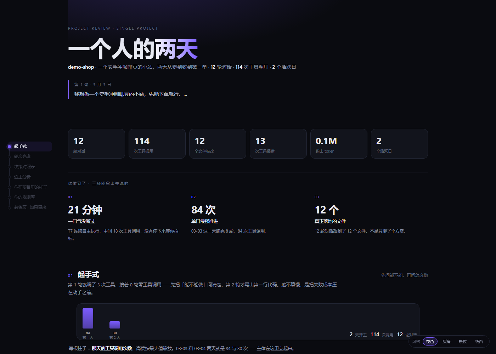

# vibe review

**English** · [中文](README.zh-CN.md)

**Live demo:** https://heyiai02.github.io/vibe-review/ (Chinese) ·
[English](https://heyiai02.github.io/vibe-review/en/) — a 12-turn fictional project, all six sections

Turn your AI coding sessions (Claude Code, DeepSeek Harness, or any `vibe-events` JSONL) into a
**single-page HTML retrospective**: which turns moved the project forward, where you actually reworked
something, how you give instructions, and what to say differently next time.

Not a dashboard. Not a token counter. **Numbers are computed; the narrative is written from your own words.**



## Quick start

```bash
git clone https://github.com/HeYiai02/vibe-review.git && cd vibe-review

# 1. collect  (short project name for DSH; add --cc for Claude Code)
node collect.js my-project project.json
node collect.js my-project project.json --cc

# 2. write the narrative (decisions / rework / rules) into curated.json
$EDITOR curated.json

# 3. merge + render
node build.js project.json data.json curated.json
DATA=data.json OUTHTML=my-project-review.html node render.js

# 4. health check
node check.js data.json

# 5. derived artifacts (Markdown / metrics.json / share cards)
node export.js data.json out
```

No logs yet? Generate a fake project and see the output first:

```bash
node demo/make-demo.js
node build.js demo/project.json demo/data.json demo/curated.json
DATA=demo/data.json OUTHTML=docs/index.html node render.js
node check.js demo/data.json
```

## Pipeline

| Step | Script | Output |
|---|---|---|
| collect | `collect.js` + `readers.js` | `project.json` — measured facts only (turns, tool calls, errors, files, tokens) |
| merge | `build.js` | `data.json` — facts + your narrative; anchors are resolved here |
| render | `render.js` | `<project>-review.html` — one file, gzip-inlined data, opens offline |
| derive | `export.js` | `out/*.md`, `out/*.metrics.json`, `out/*-card-{v,h}.html` |

`check.js` asserts: turn totals add up, session ranges are contiguous, every anchor resolves,
rework share is sane, and there are no plaintext passwords or bare IPs in the data.

## Data sources

| Source | Command | What counts as a "turn" |
|---|---|---|
| DeepSeek Harness | `node collect.js <name> out.json` | one human input |
| Claude Code | `node collect.js <name> out.json --cc` | one human input |
| Anything else | `node collect.js --events <file.jsonl>` | you export it per the `vibe-events` model |

**One git repository = one project.** Ownership is decided by walking up from each edited file to `.git`,
so a single "project" can be assembled from several sessions and several agents.

Semantic differences bite harder than format differences: the number of assistant messages in Claude Code
is *not* the number of turns, and OpenAI-style logs fold cached tokens into `input` while Anthropic reports
`cache_read_input_tokens` separately. This tool counts one turn per human input and only sums `output` tokens.

## The narrative is hand-written (by design)

Scripts can count; they cannot remember why you changed your mind. Decisions, rework episodes and rules
go into `curated.json`, written by you (or by a model after reading the original messages).
Contract, field table and anchor rules: **[SKILL.md](SKILL.md)**.

## Language

`REVIEW_LANG=en` renders the whole report UI in English — try
[the English demo](https://heyiai02.github.io/vibe-review/en/) next to
[the Chinese one](https://heyiai02.github.io/vibe-review/).

What is language-independent and what is not:

- **UI** (headings, labels, buttons, the q-score explainer, the coach prompts) — bilingual, via
  `i18n/zh.json` / `i18n/en.json` plus inline `TX(zh, en)` pairs in `app.js`.
- **Narrative** (decision titles, rework causes, rules) — written by a human or model in `curated.json`,
  so it comes out in whatever language you wrote it in. The demo ships `demo/curated.en.json` for this reason.
- **Your own session logs** stay in the language you typed. That is the point — we are not translating
  your words, only the frame around them.

Vocab note: the Chinese section names (起手式 / 返工 / 教练页) are load-bearing in the Chinese version.
The English build translates them (Opening move / Rework analysis / Coach page) rather than romanising them.

## Known limits

- User messages are not truncated (longest seen: 9,542 chars); assistant replies are cut at 1,500 chars.
- Cloud-only sessions (Cursor, web chat) have no local logs and cannot be read.
- Single-session projects show "work segments" instead of "sessions" (>3h gaps split them).
- `export.js` writes share cards as HTML; convert to PNG yourself (command in SKILL.md §7.2).
- Each decision comparison is tagged *fact* (from logs) or *inference* — inference is dashed purple in the
  page and marked `†` in Markdown.

## License

MIT
